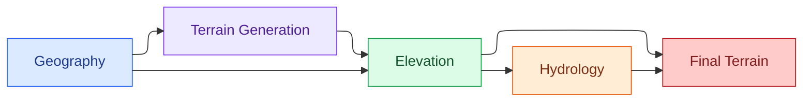
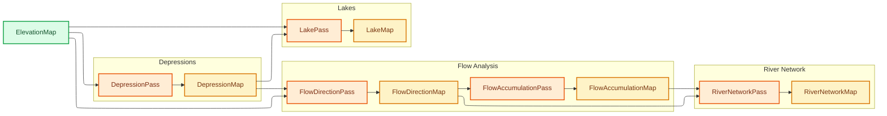
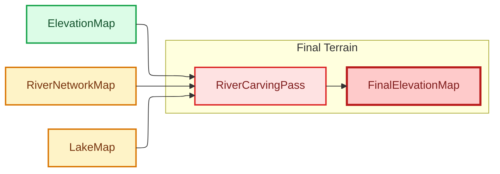

# Params
## GeographyParams
Controls the large-scale geographical structure of the world.
- continentalness: ContinentalnessParams
- ocean: OceanParams
- coast: CoastParams

## TerrainParams
Controls terrain formations and their resulting elevation.
- mountains: MountainParams
- hills: HillParams
- valleys: ValleyParams
- plateaus: PlateauParams
- seaLevel: SeaLevelParams
- elevation: ElevationParams

## GeologyParams
Controls geological processes and properties.
- tectonics: TectonicParams
- volcanism: VolcanismParams
- erosion: ErosionParams
- bedrock: BedrockParams

## ClimateParams
Controls environmental and atmospheric conditions.
- temperature: TemperatureParams
- moisture: MoistureParams
- wind: WindParams
- latitude: LatitudeParams

## HydrologyParams
Controls water movement and surface water.
- rivers: RiverParams
- lakes: LakeParams
- drainage: DrainageParams

# Passes
## Global

## Geography

```mermaid
%%{init: {
    "flowchart": {
        "defaultRenderer": "elk",
        "nodeSpacing": 50,
        "rankSpacing": 80
    }
}}%%
flowchart LR

    subgraph Geography["Geography"]
        direction LR

        GP["GeographyParams"]:::params
        G["GeographyPass"]:::pass

        C["ContinentalMap"]:::map
        O["OceanMap"]:::map
        CO["CoastMap"]:::map

        GP --> G
        G --> C
        G --> O
        G --> CO

    end

    subgraph Terrain["Terrain"]
        direction LR

        subgraph Mountains["Mountains"]
            direction LR
            MP["MountainParams"]:::params
            M["MountainPass"]:::pass
            MM["MountainMap"]:::map
            MP --> M --> MM
        end

        subgraph Hills["Hills"]
            direction LR
            HP["HillParams"]:::params
            H["HillPass"]:::pass
            HM["HillMap"]:::map
            HP --> H --> HM
        end

        subgraph Valleys["Valleys"]
            direction LR
            VP["ValleyParams"]:::params
            V["ValleyPass"]:::pass
            VM["ValleyMap"]:::map
            VP --> V --> VM
        end

        subgraph Plateaus["Plateaus"]
            direction LR
            PP["PlateauParams"]:::params
            P["PlateauPass"]:::pass
            PM["PlateauMap"]:::map
            PP --> P --> PM
        end

        MP ~~~ HP
        HP ~~~ VP
        VP ~~~ PP
    end

    C --> M
    CO --> M

    C --> H
    M --> H

    C --> V
    M --> V
    H --> V

    C --> P
    M --> P
    H --> P

    classDef params fill:#dbeafe,stroke:#2563eb,color:#1e3a8a,stroke-width:2px
    classDef pass fill:#ede9fe,stroke:#7c3aed,color:#4c1d95,stroke-width:2px
    classDef map fill:#dcfce7,stroke:#16a34a,color:#14532d,stroke-width:2px

```

## Elevation

## Hydrology

## Final
