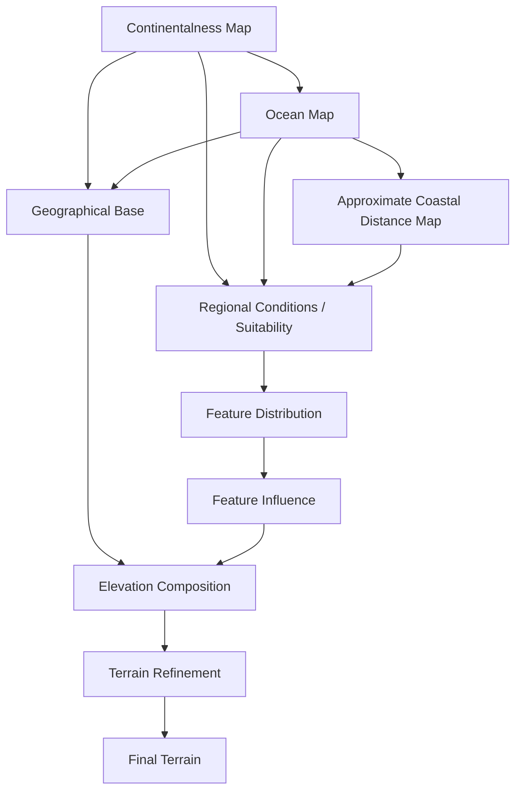

# World Generation Pipeline

> **Status:** Proposed architecture  
> **Scope:** Procedural geography and terrain generation  
> **Implementation status:** This document describes the intended pipeline, not the current implementation.

## 1. Design principles

The generator should establish large-scale geography before generating terrain formations.

The pipeline separates six responsibilities:

1. **Geography:** Where continents, oceans and coastlines are.
2. **Suitability:** Which terrain formations are appropriate in a region.
3. **Distribution:** Where formations actually occur.
4. **Influence:** How far formations affect their surroundings.
5. **Elevation:** The resulting vertical shape of the terrain.
6. **Refinement:** Later processes that modify the composed terrain.

These concepts should not be collapsed into one noise map or one large elevation formula.

### 1.1 Geography comes before terrain

Mountain placement should depend on geographical context. Mountains can occur inland, near coasts or underwater, but their likelihood and characteristics should depend on their surroundings.

### 1.2 Conditions are continuous

Do not require fixed base biomes and sub-biomes.

Regional conditions should generally produce continuous values between `0` and `1`. Multiple conditions can overlap.

Examples:

- Mountains + coastline → coastal cliffs.
- Mountains + continental edge → increased volcanic suitability.
- Mountains + inland → large mountain ranges.
- Hills + plains → rolling terrain.

These are conditions, not mutually exclusive categories.

### 1.3 Separate feature core from influence

A feature mask identifies where a formation occurs. It does not describe the full area affected by that formation.

Keep these responsibilities separate:

- Suitability: whether a feature is appropriate.
- Distribution: where its core formations occur.
- Influence: how far it affects surrounding terrain.
- Profile: how its contribution changes through its influence area.
- Amplitude: how much vertical displacement it contributes.

This allows mountain height to change without changing mountain placement, and foothill width to change without changing the mountain core.

### 1.4 Generation remains explicit

Preserve the existing architecture:

- Generating a map ensures its dependencies exist.
- Maps are cached by generator type.
- Regeneration is explicitly requested.
- Parameter changes do not automatically regenerate maps.
- Dependent maps are regenerated through explicit generation calls.

### 1.5 Maps should be inspectable

Intermediate maps should eventually be viewable independently in the editor. This is essential for identifying whether an unexpected result comes from geography, suitability, distribution, influence or elevation.

---

## 2. Coordinate system and values

The world currently uses one horizontal world unit per metre and one block per metre.

Recommended conventions:

| Data | Representation |
|---|---|
| Horizontal position | Metres |
| Coastal distance | Metres |
| Feature distance | Metres |
| Suitability | `0..1` |
| Distribution mask | `0..1` |
| Influence | `0..1` |
| Elevation | Metres relative to sea level |

Elevation must support negative values.

Sea level is a reference elevation, not the lower bound of terrain.

The relationship between `WorldParams.size.y` and the eventual vertical range in metres needs to be explicitly defined.

---

## 3. Pipeline overview

The intended order is:

1. Global continental structure.
2. Ocean distribution and basin characteristics.
3. Approximate coastline and coastal distance.
4. Regional conditions and feature suitability.
5. Feature-core distribution.
6. Feature spatial influence.
7. Base terrain and elevation composition.
8. Terrain refinement.



These are logical stages. They do not necessarily require one class per box.

---

## 4. Stage 1 — Global continental structure

### ContinentalnessMap

**Purpose:** Establish the broad geographical structure of the world: continents, continental interiors, continental margins and oceanic regions.

Continentalness is not a mountain map and should not directly generate elevation.

It should describe structures at several scales:

- **Continental scale:** Positions, sizes and shapes of major continents and ocean basins.
- **Regional scale:** Irregularities in continental outlines, peninsulas, gulfs and broad indentations.
- **Boundary variation:** Smaller coastline irregularities.

Continental-scale structure must dominate. Simply adding several equally strong noise layers tends to produce incoherent noise instead of recognizable continents.

Conceptually:

```text
continentalness =
    continental shape
    + regional boundary distortion
    + smaller boundary variation
```

This is a conceptual decomposition, not a prescribed formula.

### Geographical interpretation

The output should be a continuous scalar field.

| Relative value | Interpretation |
|---|---|
| Strongly negative | Oceanic region |
| Negative | Outer ocean / possible shelf region |
| Around transition | Continental margin |
| Positive | Continental lowlands and interior |
| High positive | Deep continental interior |

The exact ranges are configurable.

### Parameters

| Parameter | Responsibility |
|---|---|
| Continental scale | Typical size of major structures |
| Continental count / size distribution | Broad landmass distribution, if explicitly controlled |
| Shape distortion | Irregularity of outlines |
| Regional variation | Large-scale boundary features |
| Boundary detail | Smaller coastline irregularity |
| Seed | Reproducible variation |

**Output:** `ContinentalnessMap`.

**Influences:** Ocean distribution, approximate coastline, regional suitability and geographical base elevation.

It should not directly determine mountain height, biome identity or local elevation detail.

---

## 5. Stage 2 — Ocean distribution and basin characteristics

### OceanMap

**Purpose:** Establish ocean regions and their broad basin characteristics using continentalness as input.

Continentalness describes the broad continental field. OceanMap turns that context into an ocean-specific representation.

OceanMap should distinguish:

- Ocean coverage.
- Broad ocean basins.
- Deep-ocean regions.
- Shallow continental shelves.
- Approximate land/ocean boundary.

The ocean boundary at this stage is approximate. The final coastline is determined by the final terrain intersecting sea level.

### Existing OceanParams

The repository already contains:

- `seaLevel`
- `seaLevelVariation`
- `scale`
- `depth`
- `coastFalloff`
- `coverage`

Their semantics need clarification.

| Parameter | Intended responsibility |
|---|---|
| Coverage | Proportion or threshold of the world classified as ocean |
| Scale | Broad ocean-basin variation |
| Depth | Potential basin depth |
| Coast falloff | Shelf transition width |
| Sea level | Vertical reference for underwater terrain |
| Sea-level variation | Defined variation of the sea-level reference, if retained |

Sea level must not be confused with seabed depth.

**Output:** `OceanMap`.

**Influences:** Coastal distance, ocean-floor elevation, coastal conditions and later marine systems.

---

## 6. Stage 3 — Approximate coastline and coastal distance

### CoastalDistanceMap

**Purpose:** Calculate approximate distance from each location to the nearest coastline using the initial OceanMap boundary.

The final coastline does not exist yet because elevation has not been composed.

A distance field is more useful than a simple coastal/not-coastal classification.

Examples:

- Mountain suitability can increase farther inland.
- Coastal cliffs can be more suitable close to the coast.
- Coastal plains can occupy a wider band.
- Climate and vegetation systems can use their own distance ranges.

### Representation

Store distance in metres, not normalized `0..1` values.

A consumer can normalize it against its own range:

```text
normalizedDistance = clamp(distance / influenceRange, 0, 1)
```

A signed distance may be useful:

- Negative on the ocean side.
- Zero at the approximate coastline.
- Positive on the land side.

Alternatively, use unsigned distance and a separate land/ocean classification.

### Parameters

| Parameter | Responsibility |
|---|---|
| Maximum useful distance | Distance beyond which values saturate |
| Distance resolution | Accuracy/performance trade-off |
| Boundary source | Which OceanMap boundary is used |
| Sign convention | How land and ocean sides are represented |

**Output:** `CoastalDistanceMap`.

**Influences:** Regional suitability, coastal cliffs, coastal plains and other proximity-dependent systems.

---

## 7. Stage 4 — Regional conditions and feature suitability

**Purpose:** Determine which terrain formations are appropriate at each location.

Suitability answers: "Could this feature occur here?"

It does not yet create the actual formation.

### Inputs

- Continentalness.
- Ocean context.
- Approximate coastal distance.
- Regional procedural variation.
- Optional geological context.

Later systems may add tectonic plates, hydrology and climate.

### Example suitability fields

| Suitability | Possible inputs |
|---|---|
| Mountain | Continentalness, coastal distance, regional variation, later tectonics |
| Hill | Continentalness, coastal distance, regional variation |
| Valley | Continentalness, mountain context, later hydrology |
| Plateau | Continentalness, mountain context, regional variation |
| Coastal cliff | Coastal distance, terrain and geological context |
| Volcanic | Tectonic context, mountain context, ocean/continental setting |

These are examples, not a mandatory fixed list.

### Combining conditions

Mountain suitability can be high inland, but also high near an active continental margin.

A simple rule that always suppresses mountains near the coast would be incorrect.

**Output:** Continuous suitability fields such as `MountainSuitabilityMap` and `HillSuitabilityMap`.

**Influences:** Feature distribution only. Suitability should not set feature height.

---

## 8. Stage 5 — Feature-core distribution

**Purpose:** Determine where actual terrain formations occur within suitable regions.

Suitability answers whether a feature can occur.

Distribution answers where it actually occurs.

Conceptually:

```text
feature distribution =
    suitability combined with regional distribution pattern
```

The combination should preserve the meaning of both inputs. It should not automatically be a plain multiplication if that produces undesirable behavior.

### Potential maps

- `MountainMaskMap`
- `HillMaskMap`
- `ValleyMaskMap`
- `PlateauMaskMap`

These represent formation cores or distribution strength, not final height.

### Parameters

| Parameter | Responsibility |
|---|---|
| Formation scale | Typical formation size |
| Distribution frequency | How often formations occur |
| Regional variation | Irregularity |
| Suitability response | How strongly suitability affects placement |
| Seed offset | Independent reproducible variation |

Mountain frequency and scale affect formation placement. Mountain height affects vertical contribution later.

**Output:** Feature distribution masks.

---

## 9. Stage 6 — Feature spatial influence

**Purpose:** Calculate the area affected by each feature and how its influence changes with distance from its core.

A mountain range should not simply stop at the edge of its mask. Its influence extends through slopes and foothills into surrounding terrain.

Keep the original feature mask available. Do not replace it with a blurred version.

Potential outputs:

- `MountainInfluenceMap`
- `HillInfluenceMap`
- `ValleyInfluenceMap`
- `PlateauInfluenceMap`

### Parameters

| Parameter | Responsibility |
|---|---|
| Influence radius | How far the feature affects terrain |
| Transition width | How gradually influence fades |
| Influence profile | Shape of the falloff |
| Core strength | Strength at the feature core |
| Directional behavior | Future support for non-uniform influence |

Distances should be expressed in metres. Profiles can consume normalized distance.

### Interactions

- Mountain influence can blend into hill influence.
- Mountain and valley influence can form mountain valleys.
- Plateau influence can create elevated regions near mountain systems.
- Coastal conditions can modify how mountain influence meets the ocean.
- Coastal cliffs can remain abrupt.

Do not force every mountain to transition into plains.

**Output:** Feature influence fields.

**Influences:** Elevation composition.

---

## 10. Stage 7 — Base terrain and elevation composition

**Purpose:** Compose geographical base and terrain-feature contributions into one elevation field.

Conceptually:

```text
elevation =
    continental base
    + ocean basin contribution
    + mountain contribution
    + hill contribution
    - valley contribution
    + plateau contribution
    + local variation
```

This is not necessarily the final formula. Overlapping features may need blending or constraints rather than simple addition.

### Required behavior

- Elevation is relative to sea level.
- Elevation can be negative.
- Sea level is not the minimum terrain height.
- Mountains can occur inland, near coasts or underwater.
- Ocean regions can contain underwater mountains and trenches.
- Continental shelves transition into deeper ocean basins.
- Feature transitions use influence fields.
- Feature placement, influence and amplitude remain independent.

**Output:** `ElevationMap`.

The vertical units and bounds must be defined consistently. Prefer metres relative to sea level.

---

## 11. Stage 8 — Terrain refinement

**Purpose:** Improve the initial terrain after large-scale structure and elevation are composed.

Potential systems:

- Coastline refinement.
- Erosion.
- Smoothing or sharpening.
- River and drainage carving.
- Local terrain detail.
- Geological deformation.

### Coastline dependency

The initial CoastalDistanceMap is derived from OceanMap. The final coastline is where elevation intersects sea level.

Avoid an implicit circular dependency.

Initial approach:

1. Generate approximate ocean distribution.
2. Generate approximate coastal distance.
3. Generate suitability, distribution and influence.
4. Compose elevation.
5. Derive the actual coastline from elevation and sea level.
6. Keep that refined coastline as a downstream result.

If refinement later feeds back into terrain generation, make it an explicit additional iteration.

**Output:** Refined elevation and derived terrain data.

---

## 12. Dependency matrix

| Map / stage | Reads | Produces |
|---|---|---|
| ContinentalnessMap | Seed, continental parameters | Broad continental field |
| OceanMap | Continentalness, ocean parameters | Ocean regions and basin characteristics |
| CoastalDistanceMap | Ocean boundary | Approximate coastal distance |
| Suitability maps | Continentalness, ocean, coastal distance, optional geology | Suitability fields |
| Feature masks | Suitability, distribution parameters | Formation-core masks |
| Feature influence maps | Feature masks, influence parameters | Spatial influence fields |
| ElevationMap | Continentalness, OceanMap, influence fields, elevation parameters | Elevation relative to sea level |
| Refinement | Elevation and relevant geological/geographical inputs | Refined terrain |

---

## 13. Parameter ownership

Parameters should live with the system whose behavior they control.

| Group | Examples | Affects |
|---|---|---|
| Continental | Scale, shape distortion, boundary detail | ContinentalnessMap |
| Ocean | Coverage, basin scale, depth, shelf transition | OceanMap |
| Coastal | Distance range, resolution | CoastalDistanceMap |
| Suitability | Inland preference, coastal response | Suitability maps |
| Distribution | Formation scale, frequency, variation | Feature masks |
| Influence | Radius, transition width, falloff | Influence maps |
| Elevation | Mountain height, valley depth, base profile | ElevationMap |
| Geological | Tectonic, volcanic activity, hardness, erosion | Geological conditions and refinement |
| Refinement | Erosion, smoothing, local detail | Refinement outputs |

A parameter can influence downstream systems through map dependencies. For example, continental scale affects coastal distance because it changes the coastline. It should not be duplicated in coastal parameters.

---

## 14. Existing repository architecture

The current architecture is suitable:

- `World` owns `WorldParams` and `Generator`.
- `Generator` owns `WorldMap`.
- `WorldMap` lazily creates and caches maps by generator class.
- `MapGenerator` owns dimensions, data storage and generation tracking.
- Maps generate their own dependencies.
- Generation remains explicit.

Extend this architecture rather than replacing it.

### Existing maps

| Map | Intended role |
|---|---|
| `ContinentalnessMap` | Redesign as broad continental field |
| `MountainMaskMap` | Feature-core distribution |
| `HillMaskMap` | Feature-core distribution |
| `ValleyMaskMap` | Feature-core distribution |
| `PlateauMaskMap` | Feature-core distribution |
| `ElevationMap` | Final terrain composition |

### Existing parameter groups

- `ElevationParams` currently mixes continentalness, feature distribution, profiles and amplitudes. These responsibilities should eventually be separated into geography, suitability, distribution, influence and elevation groups.
- `OceanParams` exists but needs clarified semantics and connection to OceanMap.
- `GeologicalParams` contains tectonic, volcanic, erosion and bedrock values, but these are not connected to terrain generation.
- Latitude, temperature, moisture and wind belong to later environmental systems. They should not be prerequisites for initial continental generation without a specific reason.

---

## 15. Suggested implementation order

### Phase 1 — Continental foundation

1. Redesign ContinentalnessMap.
2. Define and tune continental parameters.
3. Inspect the map at world scale.

Acceptance criteria:

- Major landmasses have coherent shapes and meaningful interiors.
- Boundaries are irregular but not dominated by small noise.
- Output is continuous.
- It does not directly generate mountains or elevation.

### Phase 2 — Ocean foundation

1. Clarify OceanParams.
2. Implement OceanMap using ContinentalnessMap.
3. Represent coverage and basin/shelf characteristics.
4. Inspect independently.

### Phase 3 — Coastal distance

1. Derive approximate coastline.
2. Calculate coastal distance.
3. Choose signed or unsigned semantics.
4. Inspect independently.

### Phase 4 — Regional suitability

1. Introduce suitability calculations.
2. Start with mountain and hill suitability.
3. Add coastal and geological conditions only where defined.
4. Inspect independently.

### Phase 5 — Distribution and influence

1. Make feature masks depend on suitability.
2. Keep distribution separate from suitability.
3. Derive influence fields.
4. Configure influence distance and falloff independently.
5. Inspect core and influence maps side by side.

### Phase 6 — Elevation composition

1. Define vertical units and sea-level convention.
2. Generate geographical base and ocean-floor contributions.
3. Combine feature influence fields.
4. Permit negative elevation.
5. Inspect before refinement.

### Phase 7 — Refinement

Add coastline refinement, erosion, hydrology and local detail as explicit later passes.

---

## 16. Deferred systems

### Tectonic plates

Could eventually provide plate boundaries, convergence/divergence, subduction, uplift and volcanic conditions.

The current GeologicalParams should not be mistaken for an implemented tectonic model.

### Hydrology

Rivers, drainage basins and lakes depend on elevation and flow. They should generally be downstream of an initial elevation surface. River carving can then be an explicit refinement pass.

### Climate

Latitude, elevation, wind, moisture and ocean influence can contribute to climate. Climate can then influence biome distribution.

### Biomes

Biomes should emerge from environmental conditions. They should not be the primary mechanism for generating large-scale elevation.

### Erosion

Erosion requires an initial terrain surface and potentially hydrological information. It belongs in refinement.

---

## 17. Open design decisions

1. Should continent count and size be explicit parameters, or should major landmasses emerge procedurally?
2. Should OceanMap expose separate ocean coverage and basin-depth fields, or one structured output with multiple channels?
3. Should coastal distance be signed or unsigned?
4. Should passive and active continental margins be represented initially, or deferred until tectonics?
5. Which suitability fields need independent inspectable maps, and which can remain calculations inside feature distribution?
6. Should every feature have a dedicated influence map, or should distance/profile logic be shared?
7. How should `WorldParams.size.y` relate to elevation in metres when negative elevations are supported?

These decisions should be resolved before implementing their corresponding stages.

---

## 18. Summary

The intended flow is:

- Generate large-scale continental structure.
- Establish ocean regions and basin characteristics.
- Derive approximate coastline and coastal distance.
- Calculate regional conditions and feature suitability.
- Distribute feature cores within suitable regions.
- Calculate spatial influence.
- Compose elevation relative to sea level.
- Refine terrain in explicit later passes.

The most important separation is:

**Geography determines context. Suitability determines where a feature makes sense. Distribution determines where it occurs. Influence determines how far it affects its surroundings. Elevation determines the resulting height. Refinement improves the result.**

Each stage should have clear inputs, outputs and parameter responsibilities.
